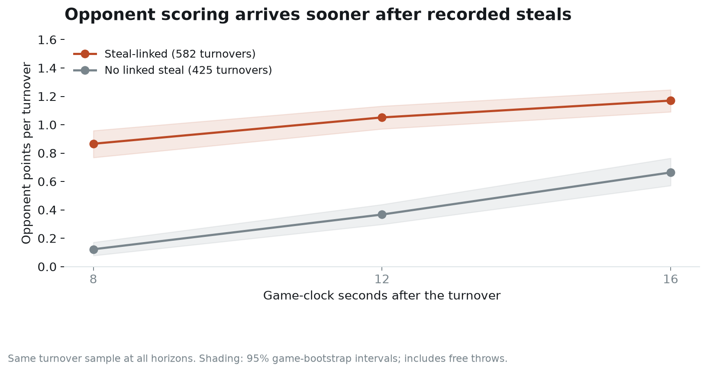
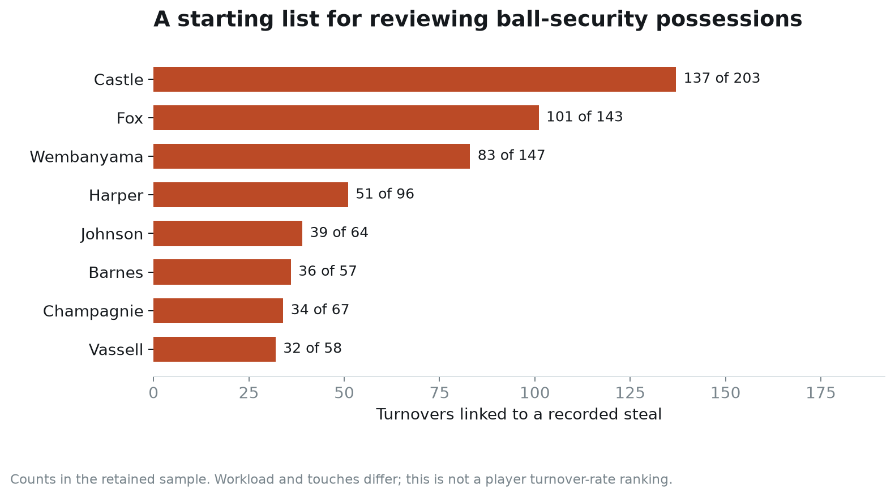

# The 12 seconds after a Spurs turnover

Joseph Smarrelli · September 2026 · 2025–26 regular season

A turnover count treats a stolen pass and a shot-clock violation as one lost opportunity each. The defensive problem that follows can be very different. In this Spurs sample, opponents scored 1.05 points in the next 12 game-clock seconds after turnovers linked to a steal, compared with 0.37 after turnovers without a linked steal.

The immediate coaching use is to organize a ball-security and floor-balance review. The result does not tell a player to avoid every risky pass, and it does not identify how many points a different decision would save.

## Define the window and the event

I used the public play-by-play for San Antonio’s 2025–26 games and checked its shot records against the separate shot feed. A game had to have an ordered clock, a nondecreasing score and scoring events that reconciled to the final totals. Three games failed these checks, leaving 79. The excluded game IDs and reasons are in the audit file.

The turnover sample includes 1,007 events with at least 16 seconds left in the period. That allows the same events to be compared at 8-, 12- and 16-second horizons. Team turnovers are included: the feed sometimes places the team ID in a field normally used for a person, which needs to be resolved before counting shot-clock violations.

A steal link requires an opponent steal record at the same clock and within the next three event rows. There are 582 such turnovers and 425 without a linked steal. The second label means exactly that. An absent steal link is not a verified classification of every turnover as a dead-ball event.

Points come from changes in the scoreboard and include free throws. The interval follows the game clock, so a foul and its free throws can fall inside the same window while no time runs. It is a fixed-time outcome, not points per possession or an official fast-break statistic.

## How large is the difference?

Opponents scored at least one point inside 12 seconds after **49.1% of steal-linked turnovers**, versus **16.9% of the other turnovers**. The difference is already visible at eight seconds. By 16 seconds, scoring after the other turnovers has begun to catch up, as a settled offense has more time to work.

I estimated a second comparison within games, adjusting for score margin, its square, quarter and time remaining. The adjusted difference at 12 seconds is **+0.69 opponent points per turnover**, with a 95% game-bootstrap interval of **+0.58 to +0.79**. All 1,007 events remain in that model because each retained game contains both categories.

The difference is about +0.72 points after removing margins above 15 points and the final two minutes of the fourth quarter or overtime. A separate check excluding windows with a timeout gives about +0.61. These are sensitivity checks, not estimates of what would happen if a timeout were removed. Whether a timeout happens is itself part of the sequence following a turnover.

Game effects absorb a shared opponent and game environment. They do not account for which five players were on the floor, where the pass was intercepted, or whether anyone was already behind the ball. Those omitted conditions matter to the mechanism.

## Where to begin the review

Castle has 137 steal-linked turnovers in this sample, Fox 101 and Wembanyama 83. Those counts help allocate review time. They do not rank ball security: touches, passing responsibility and possession load differ. The denominator shown next to each bar is that player’s retained turnover count, not touches or offensive possessions.

The repository includes 15 steal-linked events followed by the most opponent scoring inside 12 seconds. They are selected adverse outcomes, not a representative film sample. Each has a game and event identifier. Review them alongside a random selection of similar turnovers that produced no immediate score, so the review does not learn only from the worst endings.

For each event, tag the offensive action, pass destination, turnover location, number of defenders behind the ball and the first recovery responsibility. A failed pocket pass with a set low defender presents a different problem from a cross-court pass intercepted above the break. The event feed cannot supply those details reliably.

## What the number can support

The result supports treating stolen-ball turnovers as a distinct review category. It does not justify multiplying the 0.69-point difference by a proposed number of “prevented” turnovers. Avoiding a pass changes the offense too, and another choice could end in a shot, a foul, a different turnover or a later possession outcome. Some short scoring windows also overlap, so their totals are not a unique accounting of season points conceded.

A stronger decision study would pair this defensive exposure with the value of the attempted offensive action, then test a specific adjustment in comparable situations. The present work supplies the event definitions, an observed short-window benchmark and a review queue for that next step.

## Source and reproduction

NBA events and shot locations come from the [pinned public archive](https://github.com/shufinskiy/nba_data/tree/e829d4678be1e075f99e5d41a1c5f97089be446b). Source hashes, excluded games, derived turnover rows, SQL summaries and an executed notebook are included. Intervals resample games 2,000 times. This is retrospective public-data research.
