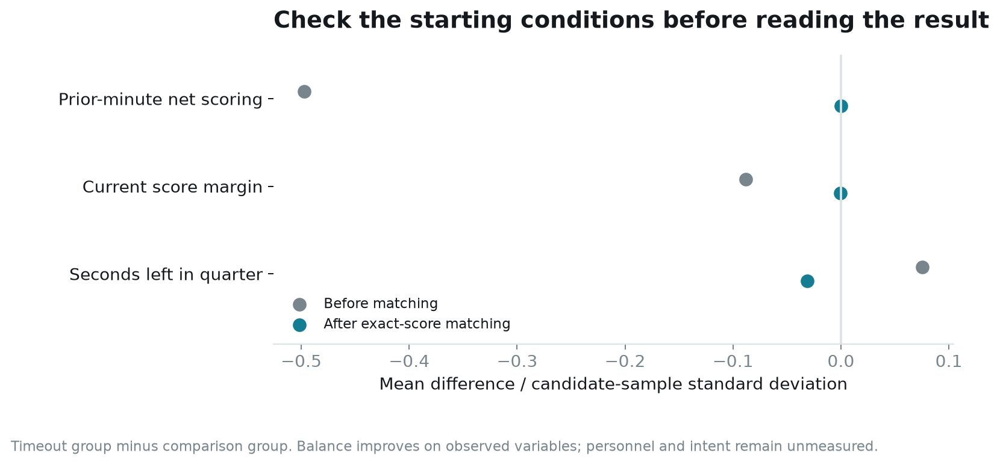
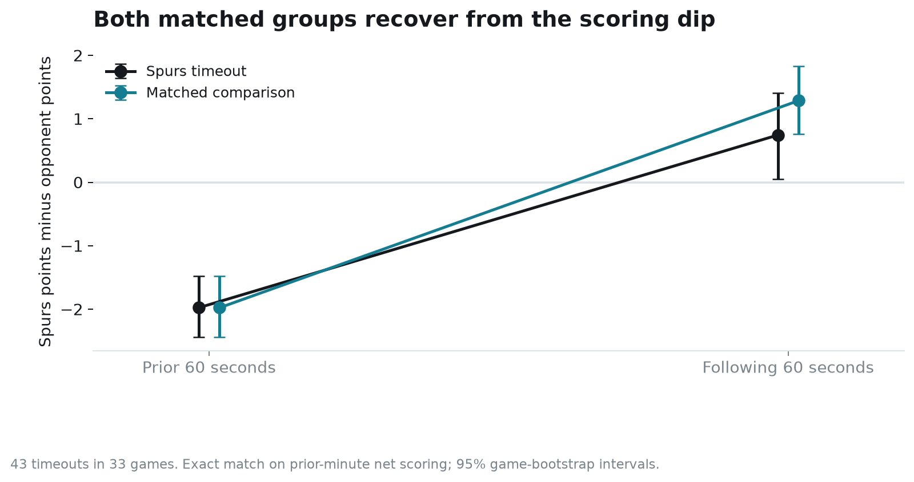
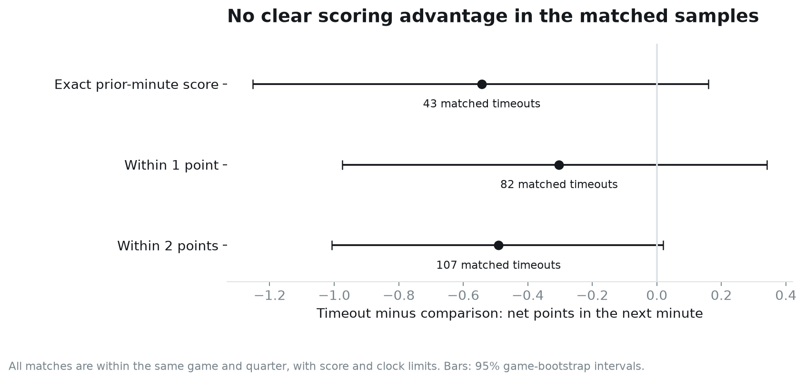

# After the timeout: a matched Spurs review

Joseph Smarrelli · September 2026 · 2025–26 regular season

The Spurs improved from a negative scoring margin in the minute before a timeout to a positive margin in the minute after it. A matched group of situations without an immediate timeout improved too. The rebound by itself is therefore weak evidence that the timeout changed the next minute.

This study asks a narrow question: after an opponent’s made field goal, how did San Antonio’s next minute compare with similar moments in the same game when neither team immediately called a timeout?

## A timeout needs a comparison moment

The candidate pool contains 2,776 opponent-made-basket moments in 79 audited games. Each has a full minute before and after it within a regulation quarter. There are 144 moments with a Spurs timeout at that clock. Moments with only an opponent timeout, or both teams calling timeouts at the same clock, are excluded.

All events at the anchor clock are processed before the following-minute window begins. That keeps same-clock free throws and stoppages out of the forward outcome. The prior-minute scoring state includes points already recorded at that clock.

For each timeout, I sought up to three comparison moments in the same game and quarter. They must have the **same prior-minute net score**, a current margin within six points and a clock separation of 90–240 seconds. The separation prevents the paired following-minute windows from being almost identical. Among eligible comparisons, a distance based on clock, margin and prior scoring chooses the closest three. Comparisons may be reused; each timeout gets equal total weight.

Only **43 of the 144 timeouts** meet this strict comparison rule. They span 33 games and use 57 distinct comparison moments. That loss of coverage matters. The result applies to situations with available matches, not every timeout or the most extreme opponent runs.

Matching removes the difference in the selected prior-minute net-score measure by construction and brings mean margin and clock close together. It does not match the sequence of scores within that minute, player fatigue, lineups, the play call or the coach’s reason for stopping the game.

## The scoring rebound occurs in both groups

Both matched groups were outscored by **1.98 points** in the prior minute. In the following minute, the timeout group outscored opponents by **0.74 points**, while the comparison group did so by **1.29 points**.

The timeout-minus-comparison difference is **−0.54 net points**, with a 95% game-bootstrap interval of **−1.25 to +0.16**. The interval includes no difference. It does not establish that timeouts help or hurt in this sample.

Looking only at the timeout group would show a 2.72-point improvement from before to after. The comparison group makes clear why that change cannot be assigned to the stoppage. A stretch ending with an opponent’s made basket and a poor recent margin can be followed by more ordinary scoring even without an immediate timeout.

## How much depends on matching strictly?

Allowing the prior-minute scores to differ by one point increases the sample to 82 timeouts. Its following-minute estimate is −0.30 points, with an interval of −0.98 to +0.34. Allowing a two-point difference retains 107 timeouts and gives −0.49, with an interval of −1.01 to +0.02. The looser comparison also leaves more imbalance in the starting scoring state.

None of these samples demonstrates a positive next-minute scoring advantage. That is a statement about the observed comparisons and their uncertainty. It is not an instruction to save timeouts.

There is another distinction: 26.4% of the weighted comparison windows contain a later timeout by either team, compared with 7.0% of the timeout-group windows. The comparison is “timeout now versus no timeout at this moment,” with subsequent decisions allowed. It is not a comparison with an enforced timeout-free minute. Excluding later timeouts after seeing them would select on something that happens after the decision point.

## What to add for a coaching review

Attach a purpose to each stoppage: stop a transition sequence, correct a coverage, rest a player, arrange a substitution or call a specific action. Separate mandatory stoppages where the record permits. The public timeout label does not resolve all those reasons.

Then pair the next-minute score with execution measures. Did the intended action occur? Was the first shot a good one? Did the coverage error recur? A useful timeout can improve those things without producing an immediate scoring gain, while a made difficult shot can make an ineffective stoppage look successful.

The delivered matching table makes each comparison inspectable. A coach or analyst can retrieve the two moments and decide whether the basketball situations are comparable. That review is the next step before treating the statistical comparison as a policy evaluation.

## Source and reproduction

Source: the [versioned public NBA archive](https://github.com/shufinskiy/nba_data/tree/e829d4678be1e075f99e5d41a1c5f97089be446b). Three games fail the shared clock, scoring or shot-feed audit and are excluded. The repository includes all candidate moments, matching rules, pair weights, balance diagnostics, sensitivity results and an executed notebook. Intervals use 2,000 game resamples to keep dependent comparisons together.
