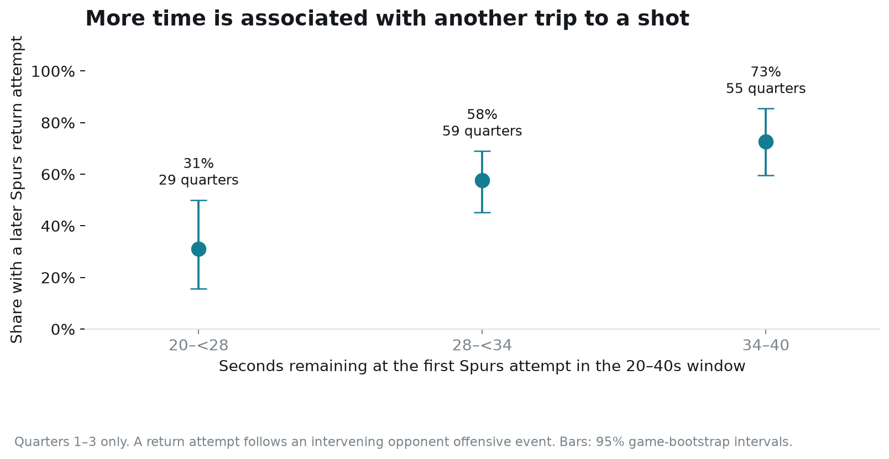
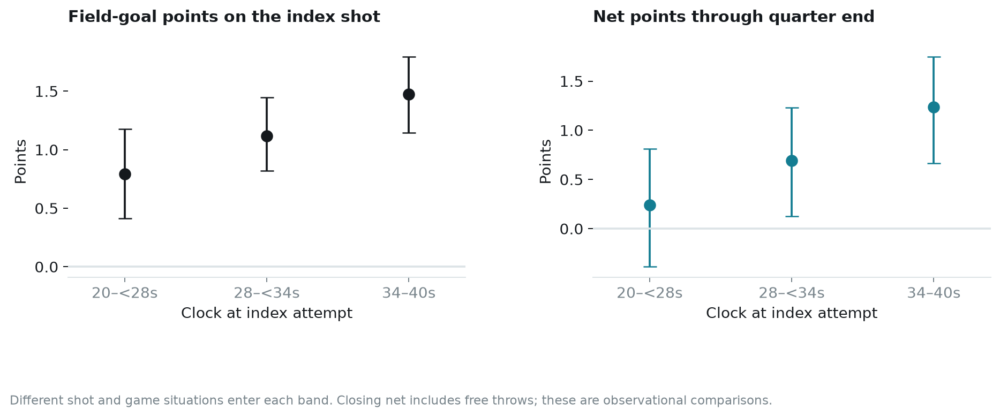
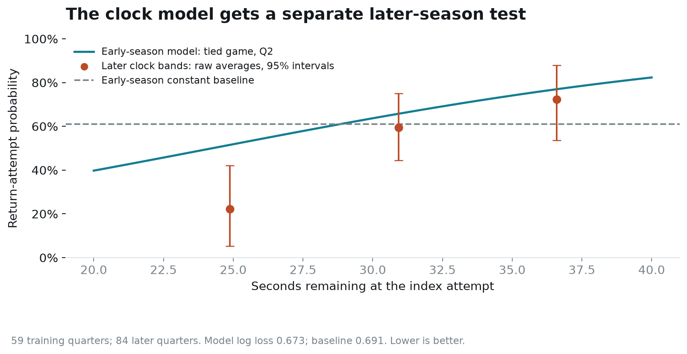

# The Spurs’ last 40 seconds of a quarter

Joseph Smarrelli · September 2026 · 2025–26 regular season

San Antonio was more likely to reach another field goal attempt when its first shot in the 20–40-second window came earlier. The return-attempt rate was 31% for index shots with 20 to under 28 seconds left, 58% with 28 to under 34 seconds, and 73% with 34–40 seconds.

That is useful evidence for reviewing two-for-one opportunities. It is not enough to prescribe an exact shooting deadline: the clock at a shot also reflects how the possession developed and what the defense allowed.

## An observable version of the two-for-one question

The [NBA shot-clock rule](https://official.nba.com/rule-no-7-24-second-clock/) generally starts a new possession at 24 seconds, with specified exceptions. This creates the familiar incentive to leave enough time for an opponent’s possession and a return trip. Whether that return becomes a good attempt depends on the events between the two shots.

I selected the first Spurs field goal attempt between 20 and 40 seconds remaining in each of quarters one through three. Quarter four and overtime are excluded because end-game fouling, score protection and possession choices change the problem. There is at most one index attempt per quarter.

A **return attempt** means another Spurs field goal attempt after an intervening opponent offensive event: a field goal attempt, turnover or nontechnical free throw. An immediate second shot after San Antonio’s own offensive rebound does not qualify on its own. This is an event-based marker, not a full possession parser; a foul-only return trip with no Spurs field goal attempt does not count.

The audited sample contains 143 eligible quarters in 74 games. Quarters with no Spurs field goal attempt in the window are absent. Their omission prevents this study from estimating the value of a universal policy applied whenever the game clock reaches 40 seconds.

## What happened after earlier attempts?

The 34–40-second group had 55 observations and a 72.7% return-attempt rate, with a 95% game-bootstrap interval of 59.6% to 85.5%. The 20-to-under-28-second group had 29 observations and a 31.0% rate, with an interval of 15.6% to 50.0%.

The earlier group also scored more on its index shots: **1.47 field-goal points per attempt**, versus **0.79** in the latest group. Net scoring from the index shot through quarter end averaged **+1.24** and **+0.24** points, respectively. Closing net scoring includes free throws; index-shot production does not.

These raw results do not reveal a measured cost from rushing the first shot. They also do not prove that forcing an earlier shot would preserve its quality. An open early opportunity may be taken immediately, while a difficult possession may take longer. The source contains the result and clock, but no reliable label for intent, shot-clock time, contest distance or the action the coach wanted.

The index attempt may itself follow an offensive rebound, and the rest of the quarter may contain multiple trips. Those possibilities belong in the film review rather than being silently counted as a clean two-for-one sequence.

## Test a clock model on later games

I trained a regularized logistic model on **59 eligible quarters before January 1**, then evaluated it on **84 later quarters**. Inputs are the index-shot clock, the score margin before the shot and quarter indicators. The first shot’s make or miss is deliberately excluded from the predictors. A constant forecast equal to the early sample’s return-attempt rate is the baseline.

The model’s later-sample log loss is **0.673**, compared with **0.691** for the constant baseline. Lower is better. The paired difference is −0.019, with a 95% game-bootstrap interval from **−0.097 to +0.060**. The point estimate favors the model, but the interval does not establish a reliable predictive improvement.

The line shows the early model for a tied game in quarter two. The orange points are raw later-sample averages within clock bands, with game-bootstrap intervals. Their margins and quarters vary, so the points are a descriptive check rather than a formal calibration curve for that particular scenario.

## A usable review plan

Start with the 28-to-under-34-second band, where some sequences produce a return attempt and others do not. The derived table records the index event, the first intervening opponent event and the return event when one exists. Review how much time is spent after the first shot on the rebound, inbound, ball advance and opponent action.

For possessions where San Antonio has an opportunity to choose the timing, tag the available shot and the alternative action. That decision-state information would allow an analysis of the opportunity cost of shooting sooner. The current dataset selects on a shot already being taken, so its clock model should not be treated as a live recommendation engine.

The observed gradient is a reason to practice and review these windows. The evidence does not identify a single optimal deadline or prove a points gain from changing the team’s timing rule.

## Source and reproduction

Events and shot records come from the [pinned NBA public-data archive](https://github.com/shufinskiy/nba_data/tree/e829d4678be1e075f99e5d41a1c5f97089be446b). The repository includes all 143 index events, return-event identifiers, source exclusions, model coefficients, later predictions, SQL summaries and an executed notebook. All reported intervals resample games 2,000 times. This is historical research, not a deployed coaching tool.
